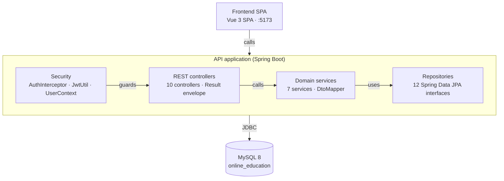

# Component Diagram

**Online Personal Education Platform — C4 level 3 (concise).**

Zooms into the **API application** container from the [container diagram](system-container-diagram.md).
Dependencies below were read from the constructor injection fields of every controller and service:

* controllers depend only on services (`grep "private final" controller/*.java`)
* services depend on repositories plus `DtoMapper`; `QuizService` additionally uses a Jackson `ObjectMapper`
* `AuthInterceptor` depends on `JwtUtil` and `ObjectMapper`, and writes to `UserContext`

| File | Use |
| --- | --- |
| `system-component-diagram.svg` | Main diagram, 680 × 584, transparent background |
| `system-component-diagram.mmd` | Mermaid `flowchart TB`, renders on GitHub and docs sites |
| `system-component-diagram.puml` | C4-PlantUML component source |

---

## The diagram



---

## Components

| Component | Key classes | Responsibility | Depends on |
| --- | --- | --- | --- |
| **Security** | `AuthInterceptor`, `JwtUtil`, `JwtProperties`, `UserContext`, `AuthenticatedUser` | Verifies `Authorization: Bearer <token>` on every `/api/**` call, puts the caller into a ThreadLocal, and enforces the ADMIN role. | `JwtUtil`, Jackson |
| **REST controllers** | 10 classes, `GlobalExceptionHandler`, `Result`, `PageResult` | Thin HTTP layer: validate, delegate to a service, wrap the answer in `{ code, message, data }`. | 7 services |
| **Domain services** | `AuthService`, `CourseService`, `EnrollmentService`, `StudyPlanService`, `QuizService`, `RecommendationService`, `DashboardService`, `DtoMapper` | All business rules: BCrypt + JWT issuing, catalogue queries, progress counters, plan generation, quiz grading, the recommendation score, statistics. | 12 repositories, `DtoMapper` |
| **Repositories** | 12 Spring Data JPA interfaces, 12 JPA entities | Entity persistence and derived queries. | MySQL via HikariCP |

## Request path

```
SPA → AuthInterceptor → controller → service → repository → MySQL
```

`AuthInterceptor` runs on `/api/**` except the six public paths (`/api/auth/login`,
`/api/auth/register`, `/api/health`, `/api/categories`, `/api/courses`, `/api/courses/**`).
`CORS` pre-flight `OPTIONS` requests pass through untouched. Services never call each other's
repositories directly, and controllers never touch a repository — the layering is strictly one-way.

## The SPA container, for completeness

Same level of detail, without a second drawing:

| Component | Files | Responsibility |
| --- | --- | --- |
| **API client** | `api/request.js`, `api/index.js` | Axios instance on `/api`, attaches the Bearer token, unwraps the envelope, clears the session and routes to `/login` on 401. |
| **Session store** | `stores/user.js` | Pinia store holding the user and token. |
| **Router** | `router/index.js` | 22 routes with `meta.public` and `meta.admin` guards — convenience only, the API is the real gate. |
| **Views** | 14 student views, 8 admin views | One page per screen, built from `CourseCard`, `StatCard`, `EmptyState` and `MainLayout`. |
