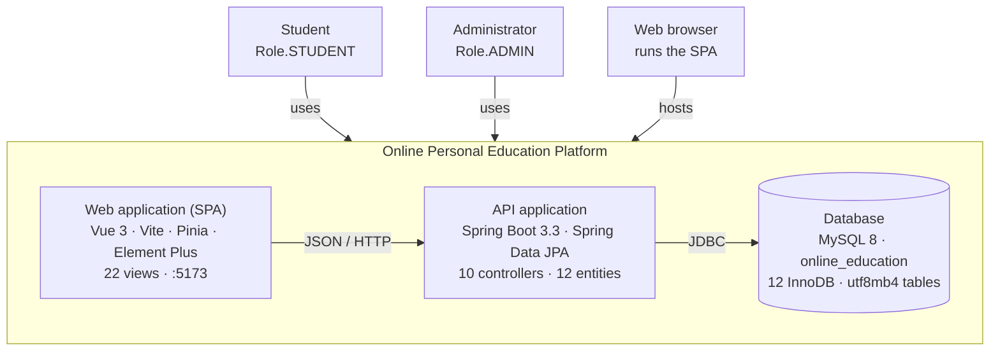

# Container Diagram

**Online Personal Education Platform — C4 level 2 (concise).**

Zoom into the system boundary of the [system context diagram](system-context-diagram.md) and show the
deployable units inside it. Counts below were read from the sources, not from the README:

* `backend/src/main/java/com/edu/platform/**` — 10 controllers, 7 services, 12 repositories, 12 JPA entities
* `frontend/src/views/**` — 14 student views + 8 admin views = 22 views

| File | Use |
| --- | --- |
| `system-container-diagram.svg` | Main diagram, 680 × 528, transparent background |
| `system-container-diagram.mmd` | Mermaid `flowchart TB`, renders on GitHub and docs sites |
| `system-container-diagram.puml` | C4-PlantUML container source |

---

Zoom in one level: [component diagram](system-component-diagram.md) for the API application.

## The diagram

---

## Containers

| Container | Technology | Responsibility | Interfaces |
| --- | --- | --- | --- |
| **Web application (SPA)** | Vue 3.5, Vite 5, Pinia 2.2, Vue Router 4.4, Element Plus 2.8, axios 1.7 | Renders every screen, holds the session and talks to the API. 22 views, 3 shared components, one `MainLayout`, one Pinia store. | Out: `GET/POST/PUT/PATCH/DELETE /api/**` on `:5173`. Served as static assets. |
| **API application** | Spring Boot 3.3.5, Spring Data JPA (Hibernate), Spring Validation, JJWT 0.12.6, `spring-security-crypto` (BCrypt) | Owns all business rules — enrolment, progress, study plans, quiz grading, recommendations, administration. 10 controllers, 7 services, 12 repositories, 12 entities, 5 DTO groups. | In: REST on `:8080`, envelope `{ code, message, data }`. Out: JDBC to MySQL. |
| **Database** | MySQL 8, InnoDB, utf8mb4 | Persists accounts, catalogue, enrolments, progress, plans, quizzes and attempts. 12 tables, `online_education`. | In: JDBC from the API only. |

## Cross-cutting behaviour held by the API container

* **Authentication** — a hand-written `AuthInterceptor` plus a `UserContext` ThreadLocal, not a Spring
  Security filter chain. `spring-security-crypto` is pulled in only for `BCryptPasswordEncoder`.
* **Authorisation** — `/api/admin/**` calls `UserContext.requireAdmin()`, which throws `403` for a
  `STUDENT` JWT. Six paths are excluded from the interceptor: `/api/auth/login`, `/api/auth/register`,
  `/api/health`, `/api/categories`, `/api/courses`, `/api/courses/**`.
* **Session handling** — the SPA stores the JWT and profile under `oep_token` / `oep_user` in
  `localStorage`; the axios request interceptor attaches `Authorization: Bearer <token>` and the
  response interceptor clears storage and redirects to `/login` on `401`.
* **CORS** — `WebConfig.addCorsMappings` allows only `http://localhost:5173` and `http://127.0.0.1:5173`.
  In development Vite proxies `/api` to `:8080`, so CORS never fires locally.

## Deployment

Two processes on one machine: the SPA is a folder of static Vite assets, the API is a Spring Boot
executable jar that opens a HikariCP pool (5–20 connections) to MySQL.

Build-time only: Maven Central (the Maven Wrapper 3.9.9) and the npm registry. Test scope only: an H2
in-memory database used by `PlatformApiIntegrationTest`. No cache, message broker, search engine or
external identity provider exists anywhere in the repository.
