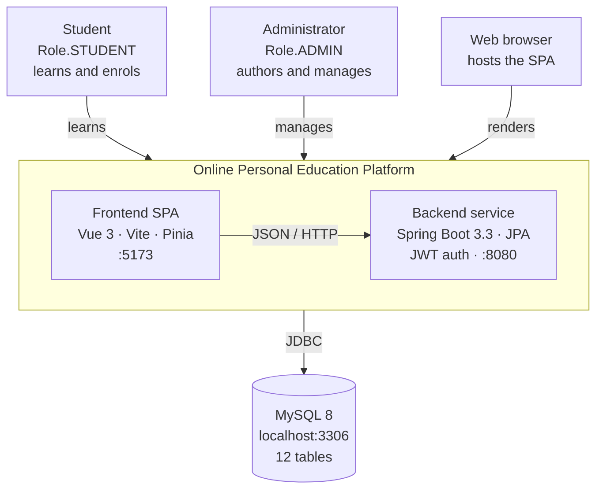

# System Context Diagram

**Online Personal Education Platform — C4 level 1 (concise).**

Verified against the actual sources: `backend/pom.xml`, `backend/src/main/resources/application.yml`,
`backend/src/main/java/com/edu/platform/config/WebConfig.java`,
`backend/src/main/java/com/edu/platform/domain/enums/Role.java`,
`frontend/package.json`, `frontend/vite.config.js`, `frontend/src/router/index.js`.

| File | Use |
| --- | --- |
| `system-context-diagram.svg` | Main diagram, 680 × 430, transparent background |
| `system-context-diagram.mmd` | Mermaid `flowchart TB`, renders on GitHub and docs sites |
| `system-context-diagram.puml` | C4-PlantUML context source |

Zoom in one level: [container diagram](system-container-diagram.md).

---

## The diagram

---

## Actors

| Actor | Role in code | What they do |
| --- | --- | --- |
| **Student** | `Role.STUDENT` | Register / sign in, browse the catalogue, enrol, tick chapters, build study plans, take quizzes, read recommendations |
| **Administrator** | `Role.ADMIN` | Everything a student can do, plus author courses, chapters, quizzes, questions and categories, and enable / disable accounts |

Both reach the system through a web browser. The split is enforced **server side**, not in the UI:
`AuthInterceptor` rejects any `/api/**` call without a valid `Authorization: Bearer <token>`, and
`UserContext.requireAdmin()` throws `403` when the JWT carries `STUDENT`. The route guards in
`frontend/src/router/index.js` are convenience only, not a security boundary.

Exactly six paths skip the interceptor: `/api/auth/login`, `/api/auth/register`, `/api/health`,
`/api/categories`, `/api/courses`, `/api/courses/**`.

## Inside the boundary

Two independently deployable units, connected by REST over JSON.

| Container | Technology | Endpoint |
| --- | --- | --- |
| **Frontend SPA** | Vue 3.5, Vite 5, Element Plus 2.8, Pinia 2.2, Vue Router 4.4, axios 1.7 | `http://localhost:5173` |
| **Backend service** | Spring Boot 3.3.5, Spring Data JPA, Spring Validation, JJWT 0.12.6, BCrypt | `http://localhost:8080` |

In development Vite proxies `/api` to port 8080, so CORS never fires locally. There is no full Spring
Security filter chain — authentication is a hand-written `HandlerInterceptor` plus a `UserContext`
ThreadLocal; `spring-security-crypto` is pulled in only for `BCryptPasswordEncoder`.

## Outside the boundary

| External system | When | Notes |
| --- | --- | --- |
| **Web browser** | runtime | Execution environment of the SPA. Hard dependency — no SSR, no mobile client, no public API consumer. |
| **MySQL 8 server** | runtime | The **only** runtime third-party dependency. `localhost:3306`, database `online_education`, 12 InnoDB / utf8mb4 tables. |
| **Maven Central** | build | The Maven Wrapper 3.9.9 (`backend/mvnw`) downloads Maven and every backend dependency. |
| **npm registry** | build | `npm install` pulls Vue, Element Plus, axios, Pinia and Vue Router. |
| **H2 in-memory** | test | `PlatformApiIntegrationTest` boots the full context against H2 and drives the real endpoints with MockMvc. |

A repository-wide search for `RestTemplate`, `WebClient`, `JavaMailSender`, `AmazonS3`, `MinioClient`,
`RedisTemplate`, `KafkaTemplate`, `RabbitTemplate`, `AlipayClient` and `openfeign` returns **zero
matches** — the platform deliberately integrates with nothing else. No email or SMS, no payment
gateway, no object storage (covers are URL strings, there is no upload endpoint), no video hosting,
no cache or broker, and no external identity provider: the backend signs and verifies its own HS256
JWTs.

## Reading the diagram

- Solid arrows are runtime flows: people and the browser point **in**, the backend writes **out** to MySQL.
- The rounded blue box is the system boundary — the two deployables this repository builds. Everything
  outside it must be provisioned, trusted, or is explicitly out of scope.
